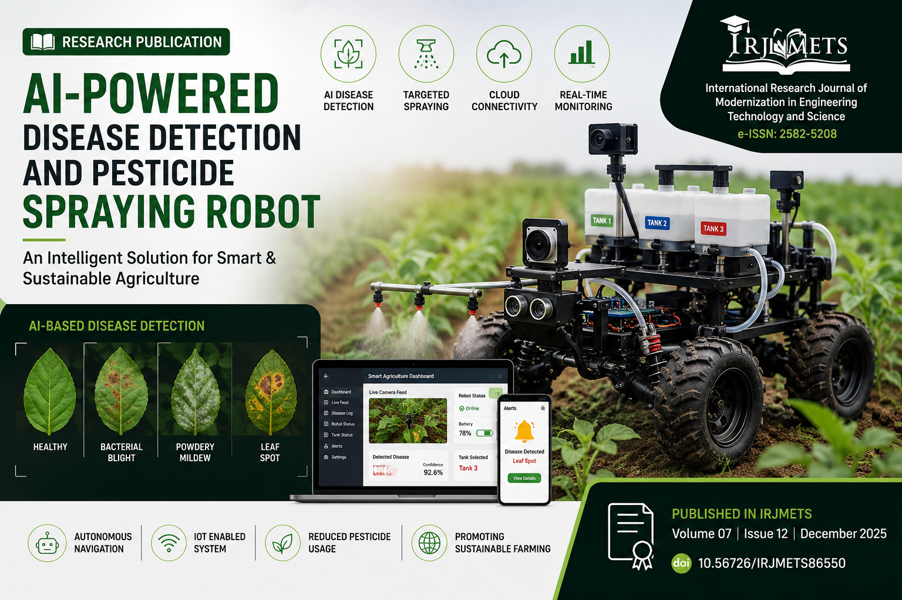

# AI-Powered Advanced Pesticide Spraying Robot with Disease Detection and Web Dashboard (AGRO VISION)

[](https://www.python.org/)
[](https://ultralytics.com/)
[](https://www.raspberrypi.com/)
[](https://react.dev/)
[](https://firebase.google.com/)
[-4CAF50?logo=solar&logoColor=white)](#power-system--sustainability)
[](#project-team--academic-credits)

> **AGRO VISION** is a sustainable, solar-powered autonomous agricultural robotic platform engineered to revolutionize precision farming. By integrating real-time computer vision (YOLOv8/CNN) with automated targeted spraying, the robot detects infected foliage on-the-fly and applies pesticide strictly to diseased leaf clusters—reducing agrochemical usage by up to **70%**, lowering operating costs by **40%**, and mitigating occupational health hazards for farmers.

---

## 👥 Project Team & Academic Credits

**Institution:** Dr. Ambedkar Institute of Technology (Dr. AIT), Bengaluru  
**Department:** Department of Computer Science & Engineering  
**Project Code:** AGRO VISION / MAJOR PROJ - DR. AIT  

| Name | University Seat Number (USN) | Role / Contributions |
| :--- | :--- | :--- |
| **Rahul Kotiyan** | `1DA22CS130` | System Architecture, Embedded Firmware & Hardware Integration |
| **Vachan U S** | `1DA22CS178` | AI/ML Pipeline, YOLOv8 Disease Detection Model & Web Dashboard |
| **Sumant Shet** | `1DA22CS168` | Chassis Mechanical Fabrication, Power Systems & Motor Control |
| **Kartik A** | `1DA23CS405` | Sensor Calibration, Cloud Telemetry & Safety Systems |

---

## 📸 Prototype & Visual Overview

<div align="center">
  
  
</div>

<div align="center">
  
  <p><em>Figure: Autonomous precision pesticide spraying robot operating across agricultural crop rows.</em></p>
</div>

---

## 🎯 Motivation & Core Objectives

### The Problem in Traditional Agriculture
* **Blanket Chemical Spraying:** Conventional methods apply pesticides uniformly across whole fields, wasting up to 70% of chemicals on healthy foliage and contaminating soil and groundwater.
* **Escalating Labor Expenses:** Manual scouting and manual knapsack spraying constitute over 40% of agricultural operational overhead.
* **Farmer Toxicity Exposure:** Continuous direct exposure to chemical sprays poses significant acute and chronic health hazards for agricultural workers.
* **Grid Dependency:** Traditional electric equipment relies on unstable rural electrical infrastructure.

### The AGRO VISION Solution
1. **Targeted Precision Treatment:** Sprays solely when a plant disease symptom is detected by computer vision.
2. **Dual Operation Modes:** Provides full autonomy with real-time obstacle avoidance, alongside low-latency web-based manual override.
3. **100% Off-Grid Solar Energy:** Powered via high-efficiency 50W photovoltaic panel and MPPT-regulated 18650 Li-ion battery bank.
4. **Cloud Telemetry & Control:** Real-time synchronization of battery levels, motor currents, detection logs, and live video through a React + Firebase web dashboard.

---


## ⚙️ Hardware Bill of Materials (BOM)

| Component | Specification | Functionality |
| :--- | :--- | :--- |
| **Microcontroller** | Raspberry Pi Pico WH (RP2040 + CYW43439 Wi-Fi) | Primary firmware controller, sensor acquisition, motor control, Firebase comms |
| **Locomotion Motors** | 4× High-Torque DC Geared Motors with All-Terrain Tires | Four-wheel drive (4WD) navigation through unpaved, uneven agricultural furrows |
| **Motor Drivers** | 2× L298N Dual H-Bridge Modules | Bi-directional velocity and steering control for 4 motors |
| **Targeted Spraying Pump**| 12V High-Pressure Diaphragm Micro-Pump | High-pressure atomization of pesticide solution via precision nozzle |
| **Spray Relay Module** | 2-Channel 5V Optocoupler Relay Board | Isolated high-current switching for the 12V pesticide pump |
| **Optical Sensor** | 1080p IP Camera (Full HD) | High-definition real-time foliage image acquisition under ambient sunlight |
| **Obstacle Avoidance** | 2× HC-SR04 Ultrasonic Distance Sensors | Real-time object and boundary detection to prevent field collisions |
| **Power Telemetry** | INA219 I2C Bi-directional Current & Voltage Sensor | High-side electrical monitoring (battery voltage, current consumption, wattage) |
| **Solar Harvesting** | 50W Monocrystalline Solar Panel | Clean renewable energy generation directly on the chassis roof |
| **Charge Controller** | MPPT Solar Charge Controller | High-efficiency buck/boost Maximum Power Point Tracking solar charging |
| **Battery Storage** | 12× 18650 Li-ion Pack (3S4P / 4S3P) with BMS | High-capacity energy reservoir for continuous field missions |
| **Mechanical Chassis** | Modular 3D-Printed Field Chassis & 1L Fluid Tank | Custom lightweight, chemical-resistant, high-ground-clearance construction |

---

## 💻 Software Stack & Subsystems

```
├── Embedded Firmware    : C/C++ / MicroPython on RP2040 Pico WH
├── Computer Vision & ML : Ultralytics YOLOv8 / Deep Convolutional Neural Networks (CNN)
├── Machine Learning API : Python Flask Microservice for Edge/Cloud Inference
├── Web Frontend         : React.js, Tailwind CSS, Lucide Icons, Chart.js
├── Backend & Database   : Firebase Realtime Database (RTDB) & Firebase Hosting
```

### 1. Vision & AI Plant Disease Detection
* Trained on curated agricultural leaf disease datasets (including early blight, late blight, leaf spots, and rust).
* High-speed visual inference pipeline:
  1. 1080p frame sampled during furrow navigation.
  2. Bounding box localization and disease class classification.
  3. Confidence threshold verification ($> 85\%$).
  4. Instantaneous command dispatch to halt propulsion and trigger micro-dosed pesticide spray.

### 2. Autonomous Operational Logic
* **Step 1:** Robot navigates crop rows at calibrated cruising speed.
* **Step 2:** Continuous IP camera stream is parsed by the inference model.
* **Step 3:** If disease detected:
  * Signal `HALT` to motor drivers.
  * Trigger 12V pump relay for $2.5\,\text{s}$ targeted burst.
  * Transmit detection timestamp, crop health status, and GPS/telemetry to Firebase.
  * Resume movement along the row.
* **Step 4:** Ultrasonic sensors continuously query $15\,\text{cm}$ safety margins. If an obstacle is detected, propulsion immediately disengages and sends an alert.

### 3. React + Firebase Dashboard
* **Real-time Telemetry:** Live gauges for battery percentage, pack voltage, current drain, and solar charging rate.
* **Dual-Mode Toggle:** One-click transition between `Autonomous` and `Manual Teleoperation`.
* **Manual Drive Controls:** Responsive directional controls (`Forward`, `Reverse`, `Pivot Left`, `Pivot Right`, `Pump Manual Spray`).
* **Audit & Event Log:** Historical audit trail of all disease detections, spray activations, and obstacle triggers.
* **Camera Stream:** Low-latency live field view.

---

## 📊 Key Results & Real-World Impact

```
┌──────────────────────────────────────────────────────────────┐
│                      PROJECT METRICS                         │
├────────────────────────────┬─────────────────────────────────┤
│ Agrochemical Reduction     │ 70% decrease in pesticide usage │
│ Operating Labor Cost       │ 40% reduction in farm expenses  │
│ Energy Self-Sufficiency    │ 100% solar powered (zero grid)  │
│ Environmental Benefit      │ Elimination of soil saturation  │
│ Human Safety Factor        │ 0% direct toxic human exposure  │
└────────────────────────────┴─────────────────────────────────┘
```

---

## 📁 Repository Contents

```
AI-POWERED-PESTICIDE-SPRAYING-ROBOT-WITH-DISEASE-DETECTION/
│
├── 20251102_2245_AI Pesticide Spraying Robot_simple_compose_01k92s0ty1e2q9fbnmpycatxd3.png  # Concept Render 1
├── 20251102_2245_AI Pesticide Spraying Robot_simple_compose_01k92s0ty2fg38n2n3rex14e7d.png  # Concept Render 2
├── 4b12494d-72cf-4e08-9d38-89715f4aa15d.png                                                 # Prototype Spraying View
├── Agro vision.docx                                                                         # Comprehensive Project Documentation
├── AI-Powered-Advanced-Pesticide-Spraying-Robot.pptx                                        # Project Presentation Deck
├── FINAL REPORT.pdf                                                                         # Complete Final Academic Report
├── .gitignore                                                                               # Git ignore specifications
└── README.md                                                                                # Project Master Documentation
```

---

## 🚀 Future Roadmap

- [ ] **RTK-GPS Integration:** Centimeter-accurate geofenced autonomous field boundary mapping.
- [ ] **Soil & Environmental Sensor Array:** In-situ NPK, soil moisture, ambient humidity, and temperature probes.
- [ ] **Multi-Crop Multi-Disease Expansion:** Edge-optimized lightweight model supporting 20+ crop species.
- [ ] **Native Mobile Application:** Cross-platform Flutter / React Native app with push notifications.
- [ ] **Drone Swarm Coordination:** Multi-agent telemetry sharing between ground robots and aerial mapping drones.

---

## 📜 Citation & License

If you use or build upon this project for academic or industrial research, please cite:

```bibtex
@misc{agrovision2026,
  title={AI-Powered Advanced Pesticide Spraying Robot with Disease Detection and Web Dashboard},
  author={Kotiyan, Rahul and U S, Vachan and Shet, Sumant and A, Kartik},
  institution={Dr. Ambedkar Institute of Technology (Dr. AIT), Bengaluru},
  year={2026}
}
```

---

<div align="center">
  <sub>Developed with ❤️ for Precision Agriculture & Environmental Sustainability by Team AGRO VISION at Dr. AIT.</sub>
</div>
